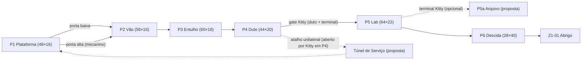
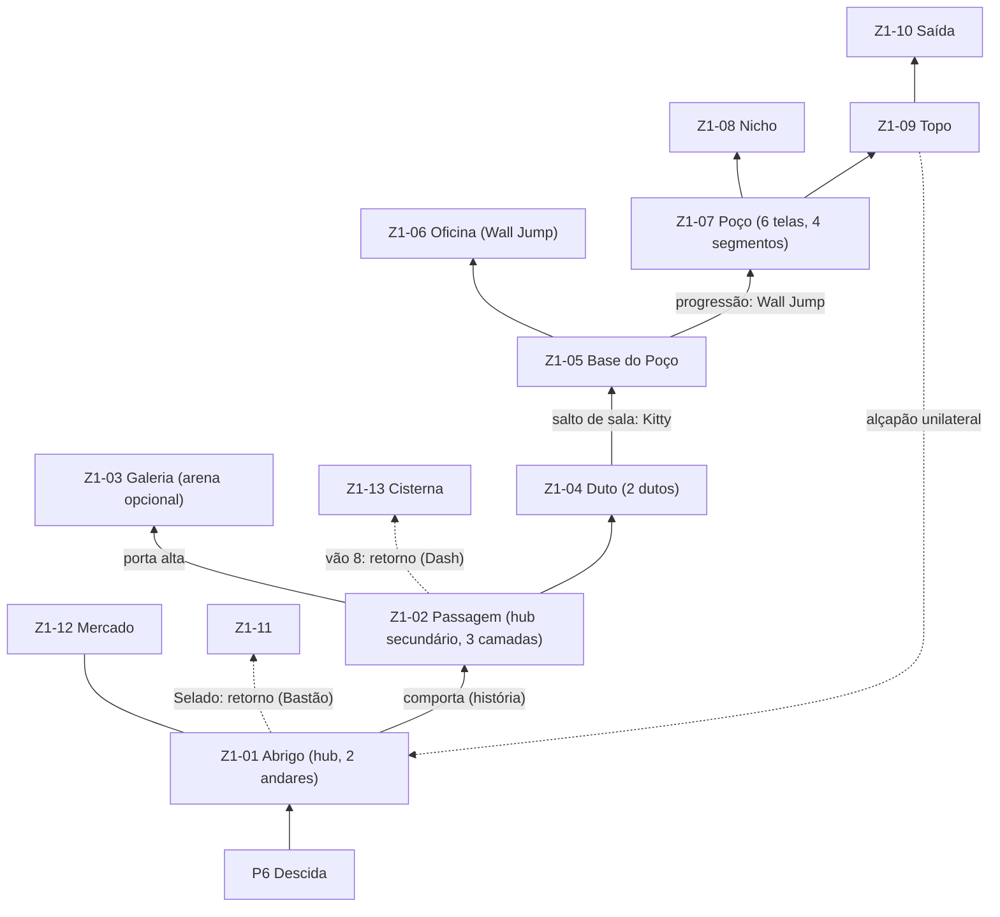

# Proposta de Level Design — Escala e Complexidade das Salas (Zona 0 e Zona 1)

> **Pedido do usuário (2026-11-13):** "aumentar o tamanho das salas e sua complexidade, está muito simples e fácil [...] ver o que podemos melhorar para aumentar o escopo das salas."
>
> **Status:** tudo neste documento é *(proposta)*. Nada aqui vira regra antes de o usuário aprovar e de a decisão entrar no `decision-log.md`, no `level-map.md` e nas histórias. Os IDs de sala já construídos (`RoomBounds.RoomId`) **não mudam**.
>
> **Canon:** não há personagens nem reviravoltas novas. O conteúdo ambiental fica dentro do que a bíblia já diz (metrô desativado, laboratório abandonado da Domus Corp que testava um modelo de robô de guerra que não foi adiante, resistência nos esgotos). Qualquer texto ou objeto que acrescente lore aparece marcado como *(proposta)*.

Bora, Desz2! O Prólogo já funciona de ponta a ponta. Agora é hora de ele ficar **gostoso de explorar**. A ideia aqui é transformar seis "telas com uma ideia cada" em seis **lugares** com rotas, segredos e um momento de prova em cada sala.

---

## 0. Referência física (valores reais dos assets)

Toda medida deste documento parte dos assets abaixo. Se o asset mudar, os números de layout precisam ser revistos.

| Valor | Atual | Onde mora |
|---|---|---|
| Corrida máx. | 8 u/s (controle aéreo ×0,85) | `Data/Abilities/PlayerMovementConfig.asset` |
| Altura máx. do pulo | 3,2 (gravidade de subida 38, queda ×1,6, corte ×0,4) | idem |
| Coyote / buffer | 40 ms / 120 ms | idem |
| Queda máx. | 22 u/s (sem dano de queda) | idem |
| Wall Jump (só a partir de Z1-06) | (6,5; 14), trava 0,05 s, deslize máx. 3,5 | idem |
| Bastão | combo 2/2/3, alcance 1,4, hitbox 1,4×1,0 | `Data/Weapons/SimpleBaton.asset` |
| Disparo | custo 5, dano 1 (bateria 100) | `PlayerRangedCombat` / `BatteryComponent` |
| Interferência de Kitty | 50 de bateria, 1,35 s, raio 4,5, cooldown 3 s | `Data/Companion/CatConfig.asset` |
| Kitty teleporta | a mais de 11 de Dante | `CatConfig.asset` (`teleportDistance`) |
| Câmera | ortográfica 5,4 → **~19,2 × 10,8** visível (16:9), confinada à sala | `RoomCamera2D` |
| Inimigos | Batedor HP 4 (10 peças) · Operário HP 6, patrulha 1,2, amplitude ±2,5 (15 peças) · Batedor Dormente HP 2 | `EnemySetupUtility` |
| Mochila | capacidade inicial **50** peças; kit médico custa 15 | `PartsPackComponent` |

### Envelope de salto (derivado)

Velocidade inicial do pulo ≈ √(2·38·3,2) ≈ 15,6 → ~0,41 s de subida e ~0,32 s de queda de volta ao mesmo nível (gravidade de queda 60,8). Com Dante a 8 u/s:

| Situação | Alcance teórico | **Teto de design** (margem de 10–15% pelo controle aéreo) |
|---|---|---|
| Vão no mesmo nível, pulo segurado | ~5,9 | **≤ 3,5** fácil · **4,5–5,0** "exige segurar" · **5,3–5,5** só em rota opcional de precisão |
| Patamar **+2,0** acima | ~4,9 | **≤ 4,0** |
| Patamar **+2,8** acima | ~4,2 | **≤ 3,5** |
| Patamar **−2,5** abaixo | ~6,7 | **≤ 5,5** |
| Degrau vertical sem Wall Jump | 3,2 | **≤ 2,8** (regra da 5.4, garante subir de volta) |
| Ganho por Wall Jump (Z1) | 14²/(2·38) ≈ 2,6 por salto, ~2,4 de deslocamento lateral | chaminés de **3–4** de largura |

### Regras de porta e spawn (project-context §6a)

- Vão de porta com **2,5** de altura. Trigger de saída com **0,6** de largura, rente à borda da sala.
- Spawn a **≥ 1,6** do trigger (o padrão atual do `LinkRooms` usa 2,6 para dentro).
- **Novidade proposta:** várias portas entre as mesmas duas salas, em alturas diferentes (porta baixa no chão, porta alta num mezanino). Hoje o `LinkRooms` assume o chão em y 0. Basta um parâmetro de altura (`doorFloorY`), uma mudança **só de script de Editor** (P).

---

## 1. Diagnóstico — por que as salas parecem simples e fáceis

1. **Uma sala = uma tela.** As salas P1–P5 têm 28–32 × 12 com a câmera mostrando 19,2 × 10,8. Na vertical a câmera praticamente não se move, e a sala inteira aparece em 1,5 tela. Não há nada "fora de quadro" para despertar curiosidade. Isso quebra o pilar §5.8, em que o segredo é **sugerido** pelo cenário: aqui não há cenário escondido para sugerir.
2. **Linha reta, uma altura.** O Prólogo é P1 → P6 em linha horizontal, com chão em y 0 em todas as salas, exceto P6. Não há camadas verticais nem escolha de rota. Isso contraria §5.2 ("verticalidade como eixo") e a primeira metade do loop de §5.1 (explorar).
3. **Cada desafio tem uma única solução e aparece uma única vez.** P2 tem 2 vãos, P3 tem 1 Operário e 1 alvo, P4 tem 1 duto, P5 tem 1 batedor. O jogador **vê** a mecânica, mas nunca é **testado** nela nem a vê combinada com outra. "Ato I ensina" (§5.12) não quer dizer "Ato I não cobra". Falta o momento de **exame** depois do ensino.
4. **Sem risco × recompensa.** P2 não causa dano (correto para o tutorial), mas também não há nada a perder nem a ganhar ao arriscar. Só existe uma recompensa por sala, sempre visível e sem custo para chegar.
5. **Nenhuma rota opcional ou segredo.** Não existe "eu quero voltar ali" (§5.1). Nenhuma sala do Prólogo tem algo visível e inalcançável que vire gate de retorno depois do Wall Jump, mesmo P6 sendo ligada ao Abrigo e o Prólogo podendo ser revisitado.
6. **Densidade de inimigos baixa e isolada.** São 3 robôs no Prólogo inteiro, sempre um por vez e, fora o alvo parado de P3, em chão plano. Como os inimigos só causam dano por contato, um combate isolado em chão plano se resolve com "andar e bater". Falta usar o **terreno** como modificador do combate (altura, plataforma estreita, teto baixo, plataforma one-way).
7. **Kitty aparece como botão, não como parceira.** O duto de P4 é "aperte E perto da porta". A interferência de P5 é "aperte R perto do robô". Nenhuma das duas pede que o jogador **pense** em onde e quando usar a Kitty (§5.11).
8. **Morte barata demais e progresso curto demais.** Hoje dá para atravessar o Prólogo em poucos minutos (estimativa: ~6–10 min), longe da meta de **20–35 min** (§5.2). Se as salas crescerem sem mais pontos de descanso, a morte passa a custar caro demais, porque o respawn do Prólogo é o início de P1. As duas coisas precisam mudar juntas.
9. **Economia de recompensa sem variedade.** Quase toda recompensa é peças, mas a mochila só guarda **50**. Um Operário já dá 15. Se as salas crescerem e espalharmos peças, a recompensa perde valor rapidinho. Precisamos variar o tipo de recompensa: célula de bateria, lore e, com código novo, upgrades.

---

## 2. Princípios de redesign

1. **Salas de 2–4 telas.** Largura de **40–64** (2–3,3 telas) e/ou altura de **14–40** (1,3–3,7 telas). Sempre há algo além da borda da câmera. Uma sala menor que 1,5 tela só para respiro ou transição.
2. **Ensinar → testar → torcer**, por mecânica e dentro da mesma sala. Primeiro um uso seguro, depois um uso com custo leve (cair = perder tempo), por fim a mecânica combinada com outra (pulo + combate, Kitty + plataforma).
3. **Uma rota opcional por sala**, com recompensa **diferente de peças** sempre que possível (célula de bateria, registro ambiental, atalho e, com código novo, upgrade).
4. **Pelo menos um segredo sugerido por sala**, com uma pista no cenário (luz piscando, rachadura, cabo entrando na parede, assimetria). Nunca um segredo aleatório (§5.8).
5. **Camadas verticais.** Toda sala do Prólogo a partir de P1 tem pelo menos dois níveis jogáveis (chão e mezanino, ou trilho e plataforma). Degraus de até 2,8 para que tudo possa ser subido de volta sem Wall Jump.
6. **O terreno é o modificador de combate.** Inimigos posicionados em plataforma estreita, em ponte sobre um fosso seguro, em patamar alto ou em plataforma one-way. Assim o mesmo Operário de 6 de vida vira três desafios diferentes.
7. **Ritmo de tensão e alívio (§5.6).** Sala de combate → sala de puzzle calma → set piece. Nada de dois picos seguidos sem respiro. O Prólogo ganha um ponto de descanso no meio *(proposta)*.
8. **Plantar o retorno.** O Prólogo tem **um gate de retorno** visível (Wall Jump) que recompensa quem volta do Abrigo depois de Z1-06, ensinando o loop de §5.1 antes de o jogador saber que ele existe.

Meta de duração: Prólogo em **20–32 min** no caminho principal + opcionais, sem contar mortes.

---

## 3. Prólogo (Zona 0) — sala a sala

### 3.0 Visão geral *(proposta)*

| Sala | ID | Atual | **Proposto** (L × A) | Telas (≈) | Tempo-alvo | Mortes-alvo |
|---|---|---|---|---|---|---|
| P1 Plataforma do Metrô | `prologue_metro_platform` | 28 × 12 | **48 × 16** | 2,5 × 1,5 | 2–3 min | 0 |
| P2 Vão | `prologue_gap` | 32 × 12 | **56 × 16** | 2,9 × 1,5 | 3–4 min | 0 (sem dano) |
| P3 Entulho | `prologue_debris` | 32 × 12 | **60 × 18** | 3,1 × 1,7 | 5–7 min | 0–1 |
| P4 Duto de Kitty | `prologue_duct` | 28 × 12 | **44 × 20** | 2,3 × 1,9 | 3–5 min | 0 |
| P5 Laboratório Escondido | `prologue_hidden_lab` | 32 × 12 | **64 × 22** | 3,3 × 2,0 | 6–9 min | 0–2 |
| P6 Descida | `prologue_descent` | 24 × 25 | **28 × 40** | 1,5 × 3,7 | 2–4 min | 0–1 |
| P5a Arquivo do Laboratório *(proposta, opcional)* | `prologue_lab_archive` | — | **24 × 14** | 1,3 × 1,3 | 2–3 min | 0 |
| T Túnel de Serviço *(proposta, opcional/atalho)* | `prologue_service_tunnel` | — | **~120 × 8** (sob P2–P3) | corredor | 1 min | 0 |

**Novas origens** (centro da sala, chão principal em y 0), sem sobreposição e com 4 de folga entre salas: P1 x 0 · P2 x 56 · P3 x 118 · P4 x 174 · P5 x 232 · P6 x 282. A Descida se estende para baixo (y 6 → −34). O Túnel fica abaixo de P2–P3, em y −14 a −6, fora dos `RoomBounds` delas.



Coordenadas abaixo são **locais** (origem = centro da sala no chão principal). "Bloco" = sólido na layer `Ground`. "One-way" = `PlatformEffector2D`.

---

### P1 — Plataforma do Metrô (`prologue_metro_platform`) · 48 × 16

**Ensina:** mover, pular, que o mundo tem **dois andares**, e que olhar para cima rende algo.

```
y11 ▓▓▓▓▓▓▓▓▓▓▓▓▓▓▓▓▓▓▓▓▓▓▓▓▓▓▓▓▓▓▓▓▓▓▓▓▓▓▓▓▓▓▓▓▓▓▓▓  teto
 y5        ════MEZANINO════════     ════BILHETERIA═══▒▒░  ← porta alta → P2
           grafite  $peças        ↑4,0↑  [pista: luz ░]  │
 y2.8    ▄▄  (escada rolante)                             
 y1.4  ▄▄          ┌──VAGÃO TOMBADO──┐                   
 y0  S ═══PLATAFORMA═══╗     (topo y1,0)    ╔══PLATAFORMA══  ← porta baixa → P2
y-2.5                  ╚═══TRILHO (fosso seguro)═══════╝
     x-24        x-6  x-4          x8   x11             x24
```

- **A. Despertar (x −24 a −14, y 0):** spawn padrão em x −20. Placa de mover/pular. Pilares e a faixa "ESTAÇÃO VALE-CINZA — LINHA 7 (DESATIVADA)" (já existem).
- **B. Escada rolante destruída (x −14 a −8):** degraus em y 1,4 e 2,8, mezanino em **y 5,0** (degrau de 2,2). O mezanino vai de x −8 a x 6.
- **C. Trilho (x −4 a 11, y −2,5):** a plataforma termina em x −4 e o leito do trilho fica 2,5 abaixo (fosso **seguro**). Um **vagão tombado** (bloco de x −1 a 8, topo em y 1,0) serve de ponte: vão de 3,0 com subida de +1,0, depois uma descida até a plataforma direita (x 11). Quem cai no trilho sai por um caixote em x −3 (topo y −1,0) e volta à plataforma (+1,5, +1,0).
- **D. Mezanino → bilheteria (opcional):** do fim do mezanino (x 6) até o patamar da bilheteria (x 10 a 24, y 5,0) há um vão de **4,0** no mesmo nível, o primeiro vão que pede "segurar" (sem dano: quem cai pousa no vagão ou no trilho). Esse patamar leva à **porta alta para P2** (porta com o piso em y 5).

**Exame:** o vagão (vão 3,0 com subida +1,0) e, para quem sobe, o vão de 4,0 no mezanino.

**Rota opcional e recompensa:** mezanino com **grafite da resistência** *(proposta: o símbolo da resistência, só imagem, sem texto novo)* e 10 peças. A porta alta leva à **passarela superior de P2**, a rota difícil da próxima sala.

**Segredo:** a bilheteria tem uma luz piscando atrás do vidro rachado (decoração). A "parede" da cabine em x 15–17 é **decoração sem colisor** e esconde um bolso com **1 célula de bateria** (já útil em P3). Na versão só com level design, Dante some atrás do decor. O fade ao entrar é código novo (ver §5b).

**Inimigos:** nenhum. **Kitty:** acompanha e sobe no ombro no mezanino (o limiar de "terreno alto" já existe, `highGroundPerchThresholdY`).

**Narrativa ambiental (canon):** estação desativada, trilhos tomados de entulho, vagão tombado. O silêncio do subsolo contrasta com a cidade lá em cima. Sem chuva.

**Dificuldade:** 1/5.

---

### P2 — Vão (`prologue_gap`) · 56 × 16

**Ensina:** pulo variável (segurar = mais longe), coyote, buffer e controle aéreo para frear. **Sem dano** (AC da 5.4 mantido).

```
 y5  ←porta alta  ═══PASSARELA DE CABOS═══  5,3  ══  5,5  ═══════╗   (rota difícil, opcional)
                                                                 ║ desce em x20
 y4                                              ▄▄ (+2,0) $ registro
 y2                                         ▄▄ (+2,0)
 y0  S ═══════╗ 3,0 ╔══╗ 4,0 ╔═╗ 4,5 ╔═╗ 5,0 ╔═══════════════════ ←→ P3
y-2.5         ╚═════╝  ╚═════╝ ╚═════╝ ╚═════╝   TRINCHEIRA SEGURA   [bolso ░]
     x-28   x-16  x-13 x-9 x-5 x-2  x2.5 x5  x10          x22   x28
```

- **Ensinar (x −28 a −16):** placa "Segure [Espaço] para pular mais longe" e um vão de **3,0** sobre a trincheira (2,5 de fundo, sem dano). Degraus de saída da trincheira a cada ~8 unidades (caixote de +1,25, depois +1,25).
- **Testar (x −13 a 10):** sequência rítmica de pilares **cada vez mais estreitos**: plataforma de 4 → vão **4,0** → pilar de 3 → vão **4,5** → pilar de 2,5 → vão **5,0** → chão. Cair custa só voltar ao início da sequência (no máximo ~10 unidades).
- **Torcer (x 10 a 28):** dois patamares ascendentes de **+2,0** cada, com 2,0 de largura e **3,5** de distância. Quem segura o pulo inteiro passa do patamar, então é preciso **frear no ar** (controle aéreo). No topo (y 4,0) fica a recompensa: um **registro de manutenção do metrô** *(proposta: placa curta, por exemplo "Linha 7 interditada por ordem da Domus. Acesso restrito ao subnível.", que prenuncia o laboratório sem acrescentar lore)*.
- **Passarela superior (opcional, vinda da porta alta de P1, y 5):** bandejas de cabos com vãos de **5,3** e **5,5** (soft gate de precisão, perto do máximo de 5,9). Recompensa: **10 peças + chegar a P3 pela porta alta**, direto no andar superior de P3. Quem cai só volta para a rota de baixo.

**Exame:** o vão de 5,0 depois de dois vãos que "funcionam sem segurar", seguido dos patamares que punem o excesso.

**Segredo:** na trincheira, sob o chão direito (x 22 a 27), há um **bolso** de 2,0 de altura, denunciado por uma luz que vaza pela grade do piso (decoração). Dentro: **grafite + 10 peças** *(o grafite é proposta: ver P1)*. Pista: a grade iluminada é visível de cima.

**Inimigos:** nenhum (sala de movimento puro). **Kitty:** segue. Em vãos longos ela pula junto ou teleporta (>11).

**Dificuldade:** 1,5/5 na rota principal e 3/5 na passarela.

---

### P3 — Entulho (`prologue_debris`) · 60 × 18

**Ensina:** bastão (combo e finalizador), recuo ao levar dano, célula de bateria + disparo, e luta em terreno elevado. Ganha **duas rotas**.

```
y13 ▓▓▓▓▓▓▓▓▓▓▓▓▓▓▓▓▓▓▓▓▓▓▓▓▓▓▓▓▓▓▓▓▓▓▓▓▓▓▓▓▓▓▓▓▓▓▓▓▓▓▓▓▓▓▓▓
 y6  ←porta alta ═══ESCRITÓRIO DE OPERAÇÕES═══  $célula ═══╗ ▒▒ [segredo]
                       grafite        ¦ one-way ¦          ║ desce p/ ponte
 y5.5                                           [Dormente]   (alvo do disparo)
 y5.6         ─── one-way                                 
 y2.8   ─── one-way    ███LAJE (Operário 2)███              
 y0  S ═══(Operário 1)═══╗▄▄(Operário 3)══ célula ══╗ ═PONTE(Op.4)═ ╔═══ →P4
y-2.5                                              ╚═══fosso seguro═══╝
     x-30          x-14  x-2   x4          x12        x16       x24  x30
```

- **Ensinar (x −30 a −14, chão):** placa do bastão, **1 Operário** (x −20) em chão plano, como hoje.
- **Testar (x −14 a 4):** um monte de entulho com degraus de 1,4 e 2,8 e uma **laje elevada** (x −2 a 4, topo em y 2,8, largura **6**, cabendo a patrulha de ±2,5). **Operário 2** patrulha a laje e **Operário 3** o chão logo abaixo. O jogador aprende a lutar de cima para baixo e a não ser imprensado.
- **Disparo (x 4 a 16):** **célula de bateria** em x 6. O **Batedor Dormente** passa para um patamar a **y 5,5** (pés), fora do alcance do bastão mesmo pulando: o pico do pulo (3,2) mais a hitbox (~1,0) chega a ~4,5. ⚠️ **Correção para o layout atual:** hoje o alvo está num patamar de topo 4,0, que provavelmente pode ser atingido com pulo + bastão. Validar no Play Mode.
- **Torcer (x 16 a 30):** uma **ponte estreita** (6 de largura) sobre um fosso seguro de 2,5, com **Operário 4** patrulhando. O knockback pode derrubar Dante no fosso: perde-se tempo, não vida. O jogador decide entre enfrentar, atirar de longe (6 disparos = 30 de bateria, uma decisão ruim, porém legítima) ou...
- **Rota superior (opcional, y 6):** one-ways em x −10 (y 2,8 e 5,6) e a porta alta vinda da passarela de P2. O **escritório de operações** desabado tem grafite, **1 célula de bateria** e uma **vista de luz ciano através das rachaduras** do lado direito (prenuncia o laboratório, decor `LabLightStrip`). A rota superior termina **depois da ponte**, então **pula o Operário 4**. É uma escolha real de rota: explorar em cima é mais seguro, mas obriga a subir.

**Exame:** a ponte, ou a laje com dois Operários em alturas diferentes.

**Segredo:** no fim do escritório, um cabo grosso (decor) entra na parede direita, que é decor sem colisor (x 27 a 29, y 6). Dentro: **20 peças** num cofre de bilheteria. Pista: o cabo e uma faixa de luz por baixo da "parede".

**Ponto de descanso *(proposta)*:** no fim de P3 (x 26, chão), um **gerador de emergência da estação** usando `ShelterRestSpot` com `isDefaultShelter = false`. Ele restaura vida, bateria e kits e vira o ponto de respawn. É o primeiro "alívio" depois do primeiro pico. Ver pergunta 2.

**Inimigos:** 4 Operários + 1 Dormente (hoje são 1 + 1). **Kitty:** sobe no ombro em combate (já implementado). A interferência ainda não foi ensinada, e tudo bem, ela chega em P5.

**Dificuldade:** 2/5.

---

### P4 — Duto de Kitty (`prologue_duct`) · 44 × 20

**Ensina:** as **duas** interações de exploração de Kitty, o duto (abrir pelo outro lado) e o terminal (destravar à distância) (GDD §5.3). Sala **calma**, de respiro depois do combate de P3.

```
y15 ▓▓▓▓▓▓▓▓▓▓▓▓▓▓▓▓▓▓▓▓▓▓▓▓▓▓▓▓▓▓▓▓▓▓▓▓▓▓▓▓▓▓▓▓▓▓
 y7.2           ═══CORREDOR DE SERVIÇO═══[PAINEL ▣]══PORTA BLINDADA══ → P5 (porta alta)
                   ║grade║ ← cai quando Kitty sai do duto 2     ┃chaminé┃ $ (Wall Jump)
 y4.8        ▄▄ [duto 2 ◘]                                    ┃ 3 larg┃
 y2.4     ▄▄                                                  ┃       ┃
 y0  S═══◘duto1═║PORTA║═══ caixotes ════ [◘duto3 → armário $] ════════════
     x-22      x-8 x-6                  x6                      x16   x22
                 alçapão ↓ (atalho p/ Túnel de Serviço, proposta)
```

- **Ensinar (x −22 a −6):** a **porta emperrada** em x −6 e o duto 1 em x −8 (como hoje, `persistentId = prologue_maintenance_door`). Kitty abre.
- **Testar (x −6 a 6):** o caminho segue **para cima**. Caixotes com degraus de 2,4 levam a um patamar em y 4,8 com o **duto 2**. Uma **grade caída** (bloco) bloqueia a subida final até o corredor em y 7,2. O duto 2 desativa a grade (`objectsToDisableOnComplete`). Agora é o jogador quem precisa **levar Dante até onde o duto está**: a Kitty não resolve sozinha.
- **Torcer (y 7,2):** no fim do corredor, um **painel offline** (`CatExplorationType.Terminal`) abre a **porta blindada** do laboratório. É a primeira vez que Kitty "lê" algo, sem explicação (§5.11, "perceber gradualmente").
- **Opcional (x 6, chão):** o **duto 3** abre um armário de manutenção com **1 célula de bateria + 10 peças**.
- **Atalho unilateral *(proposta)*:** o painel também abre um **alçapão** no chão de P4 que dá para o **Túnel de Serviço** e leva de volta a P1. A primeira lição de atalho, aberto só por este lado (§5.2).
- **Gate de retorno *(proposta)*:** junto à parede direita há uma **chaminé de 3 de largura e 8 de altura**, com um brilho no topo. Sem Wall Jump não se sobe (8 > 3,2). Ver §3.7.

**Exame:** levar Dante ao duto 2 (subir os caixotes) e perceber que o painel é "outro tipo" de interação.

**Inimigos:** nenhum (respiro). Opção para playtest: 1 Batedor Dormente no corredor, só ambientação.

**Dificuldade:** 1,5/5.

---

### P5 — Laboratório Escondido (`prologue_hidden_lab`) · 64 × 22

**Ensina:** a interferência de Kitty (`R`) e o kit médico (`Q`). É a **set piece** e o **exame final** do Prólogo, com Terminal da Domus no clímax.

```
y16 ▓▓▓▓▓▓▓▓▓▓▓▓▓▓▓▓▓▓▓▓▓▓▓▓▓▓▓▓▓▓▓▓▓▓▓▓▓▓▓▓▓▓▓▓▓▓▓▓▓▓▓▓▓▓▓▓▓▓▓▓▓▓▓
 y11                      [▣ painel → porta do Arquivo P5a (proposta)]
 y7.2 ←P4 ═CORREDOR(Batedor 1)═╗═══DECK DE OBSERVAÇÃO═══ célula ══╗ (vidro)
          teto baixo (3,5)     ║  "Isto não é manutenção..."        ║ piso quebrado ↓
 y5            [ CARCAÇA DO PROTÓTIPO DE GUERRA pendurada no guindaste (decor 4×6) ]
 y2.8              ─ one-way ─        ─ one-way ─           ▄▄ (degraus 2,4)
 y0   ═══════CÂMARA DE TESTES (Batedor 2, Batedor 3, Operário)═══════╗ ▄▄ TERMINAL DOMUS (y4,8)
                                                                     ╚═══════ → P6
      x-32     x-18          x-10                  x20        x24       x32
```

- **A. Corredor de acesso (x −32 a −18, y 7,2, teto a 3,5 do piso):** **Batedor 1** patrulha um corredor **apertado**, onde desviar por cima é difícil. Placa "[R] Kitty: interferir". Ensino seguro: um único robô e a interferência resolve.
- **B. Deck de observação (x −18 a 18, y 7,2):** visão do laboratório lá embaixo pelo vidro (decor). A **carcaça do protótipo de guerra** pende de um guindaste no meio da câmara. É canon: o modelo de robô de guerra que não foi adiante. **Célula de bateria** no deck (reabastece antes do exame). A placa existente "Isto não é manutenção do metrô... é equipamento da Domus Corp." fica aqui.
- **C. Câmara de testes, a arena (x −10 a 20, y 0):** o deck tem um trecho de **piso quebrado** em x 18. Cai-se na arena (queda de ~7, sem dano). **2 Batedores + 1 Operário**, com 2 one-ways em y 2,8 e pilares. É o primeiro combate com **mais de um robô ao mesmo tempo**: a interferência (raio 4,5) pega dois de uma vez se o jogador agrupá-los. O custo de 50 de bateria obriga a escolher entre **R ou ~10 disparos**. Placa do kit médico (`Q`) na entrada da arena.
- **D. Sala do servidor (x 20 a 32):** degraus de 2,4 até o **Terminal da Domus** (patamar em y 4,8). A saída para P6 fica no chão, em x 32.

**Exame:** a arena (bastão + disparo + R + kit médico). **Sem trava de porta** na versão só com level design: dá para fugir subindo para o servidor. A versão com `ArenaEncounter` (código novo) fecha a câmara até o fim da luta. Ver pergunta 3.

**Opcional:** um **painel** (Terminal de Kitty) no alto do deck (y 11, acessível por one-ways de 2,8) abre a porta do **Arquivo** (P5a).

**Segredo:** sob o deck, atrás da carcaça, há um nicho com **1 célula de bateria**. Pista: o cabo do guindaste entra numa parede "falsa" (decor sem colisor).

**Inimigos:** 3 Batedores + 1 Operário (hoje é 1 Batedor). **Kitty:** protagonista do combate.

**Dificuldade:** 3/5. É o pico do Prólogo, e um ponto de descanso antes dele (P3/P4) é obrigatório.

---

### P5a — Arquivo do Laboratório (`prologue_lab_archive`) · 24 × 14 · *(proposta, opcional)*

- **Acesso:** porta alta no deck de P5, aberta pelo painel de Kitty.
- **Layout:** estantes de servidores em três alturas (y 0 / 2,8 / 5,6, com one-ways). É um mini-percurso de plataforma no escuro, iluminado só pelas luzes ciano dos racks.
- **Recompensa:** **registros de teste do protótipo de guerra** em 2–3 placas curtas *(proposta: texto a aprovar pela narrativa; descreve apenas testes interrompidos e o projeto engavetado, sem nomes nem fatos novos sobre o Pai)* + 1 célula de bateria. Com o código de upgrade (§5b), seria aqui o **primeiro upgrade de capacidade de bateria**.
- **Inimigos:** 1 Batedor Dormente "guardando" o rack do topo, para o jogador praticar o disparo.
- **Pilar:** descoberta e segredos (§5.8), narrativa ambiental.

### T — Túnel de Serviço (`prologue_service_tunnel`) · ~120 × 8 · *(proposta, atalho)*

- Corredor baixo sob P2–P3 (y −14 a −6), ligando um **alçapão em P4** a uma **escotilha em P1** (x 20, chão).
- **Unilateral:** só abre a partir de P4, pelo painel de Kitty. Em P1 a escotilha é visível desde o início, trancada e "sem energia". É um gate legível, do tipo **salto de sala**.
- **Função:** se o jogador morrer em P5 sem ponto de descanso, volta de P1 a P4 em ~20 s. Ensina a lição de atalho que Z1-09 vai cobrar.
- **Conteúdo:** trilhos de serviço, sem inimigos e sem plataforma. É um corredor de retorno (ver risco R4: não deixar o túnel virar sala vazia).
- **Implementação:** é um `RoomBounds` próprio. Como as transições entre salas usam portas de 2,5, a "escotilha" é uma porta lateral num poço curto (degraus ≤ 2,8) em cada ponta.

---

### P6 — Descida (`prologue_descent`) · 28 × 40

**Ensina:** descer por plataforma fina (`S` + `Espaço`), usar a descida como **fuga** e guiar a queda no ar.

```
 y0  ←P5 ═ENTRADA═╗
 y-2.8          ──────────  (one-ways largas, ensinar)    placa [S]+[Espaço]
 y-5.6          ──────────
 y-8.4     ─────           ─────   (zigue-zague, 3–4 de deslocamento)
 y-11.2          ─────             ─────
 y-14  ═══PATAMAR ONE-WAY 8 larg (Batedor)═══  ← dá para descer por ele e fugir
 y-16.8   ─────        ─────
 y-19.6 ◄nicho░      ─────           (queda longa guiada)
 y-22.4  célula+$     ─────
 y-25.2               ─────      ─────
 y-28           ─────      ─────
 y-30.8   ─────                        ★ luz quente do Abrigo (decor)
 y-34  ═══════FUNDO══════════════════════════ → Abrigo Z1-01
       x-14                                x14
```

- **Ensinar (y 0 a −8):** duas one-ways largas empilhadas a cada 2,8 e a placa atual.
- **Testar (y −8 a −20):** zigue-zague de one-ways **alternando os lados** (3–4 de deslocamento horizontal), em que é preciso descer **e** se deslocar no ar. No meio, um **patamar one-way de 8 de largura** com um **Batedor** patrulhando. O jogador pode lutar **ou descer pelo patamar e escapar**. É a primeira vez que uma mecânica de movimento resolve um combate.
- **Torcer (y −20 a −34):** queda longa e guiada. Um **nicho na parede esquerda** (y −19,6 a −22,4, 3 de profundidade, abertura de 2,5) guarda **1 célula de bateria + 10 peças**. Pista: uma lâmpada piscando na boca do nicho. Dá para alcançá-lo de cima, guiando a queda, ou de baixo, por one-ways de 2,8.
- **Fundo:** a **luz quente do Abrigo** aparece abaixo durante a descida inteira (orientação diegética, §5.7). A saída para Z1-01 fica no chão (y −34). O spawn `from_sewers` fica a ≥ 1,6 do trigger.
- **Regra de volta:** todo o caminho fundo → topo tem degraus ≤ 2,8 (AC 7 da 5.4 mantido).

**Inimigos:** 1 Batedor. **Dificuldade:** 2/5.

---

### 3.7 Gate de retorno do Prólogo *(proposta)*

- **Onde:** a chaminé de P4 (3 de largura × 8 de altura), com brilho no topo, visível desde a primeira passagem.
- **Tipo de gate:** **4. Retorno** (Wall Jump, obtido em Z1-06). Fica legível pelo brilho e pela chaminé sem degraus.
- **Recompensa:** algo que valha a volta de ~3 salas (Abrigo → P6 → P5 → P4): o **primeiro fragmento do Pai** *(proposta narrativa: um rabisco técnico à mão, alinhado à bíblia §6, Ato II, "códigos rabiscados à mão"; texto a aprovar)* ou, com código novo, **+1 célula de vida**.
- **Por que no Prólogo:** ensina o loop de §5.1 ("eu quero voltar ali") dentro do slice, sem esperar a Zona 2.

### 3.8 Contagem do Prólogo (proposta × atual)

| Item | Atual | Proposto |
|---|---|---|
| Inimigos | 3 (1 Operário e 1 Dormente em P3, 1 Batedor em P5) | 11 (4 Op. + 2 Dorm. em P3/P5a + 4 Bat. + 1 Op. em P5/P6) |
| Rotas opcionais | 1 (patamar de P2) | 7 (mezanino, passarela, escritório, armário, deck/arquivo, nicho de P6, túnel) |
| Segredos sugeridos | 0 | 5 (bilheteria, bolso da trincheira, cofre, nicho do guindaste, nicho de P6) + 1 gate de retorno |
| Células de bateria | 1 | 6–7 |
| Peças em pickups | ~20 | ~70 (respeitando o teto de 50 da mochila; ver risco R3) |
| Pontos de descanso | 0 | 1 *(proposta)* |

---

## 4. Zona 1 (Esgotos) — como escalar

### 4.1 Regras gerais para a Zona 1

- Salas de **40–64 de largura** ou **24–64 de altura**. O Abrigo funciona como **hub** com 4–5 portas.
- Cada sala declara seu **tipo de gate** (progressão, salto de sala, coletável, retorno) e **como ele fica legível**, como o `level-map.md` exige.
- Esgotos sem chuva. Água parada pode existir como **decor** ou como fosso seguro. Água que causa dano exige `HazardVolume` (código novo).
- O Wall Jump transforma a Zona 1 **na volta**: cada sala de Z1-01 a Z1-05 deve ter **pelo menos um lugar visível só alcançável com Wall Jump** (retorno), para o atalho Topo → Abrigo valer a pena.

### 4.2 Sala a sala

| # | Sala / ID | Tamanho proposto | Estrutura | Gate e legibilidade | Inimigos | Opcional / segredo |
|---|---|---|---|---|---|---|
| Z1-01 | Abrigo `sewers_initial_shelter` | **40 × 18** (hoje 32 × 12) | **Hub em 2 andares**: chão (Icarus, `ShelterRestSpot`, porta do Selado visível), passarela superior em y 5,6 onde chega o **alçapão do atalho Z1-09**, porta lateral descendo para o Mercado | História (comporta leste); **Selado** = retorno ("sem energia", luz morta); alçapão no teto visível e fechado desde o início | 0 | Grafites e beliches da resistência; nicho em y 8,4 só com Wall Jump (retorno, 1 célula) |
| Z1-12 | Mercado da Base `sewers_base_market` | **30 × 12** | Calmo, horizontal; bancas, `BatteryChargeStation` | — | 0 | Pista sonora/visual de duto da Kitty (ligação futura) |
| Z1-02 | Passagem `sewers_passage` | **64 × 24** (hoje 36 × 14) | **Hub secundário em 3 camadas:** canal (y −3, fosso seguro), corredor (y 0), galeria de canos (y 6–9). Portas: O → Abrigo, NE alta → Galeria, L → Duto, grade no canal → Cisterna | **Cisterna:** vão alagado de **8** (> 5,9 do pulo) visível pela grade, gate de **retorno (Dash)** legível; o `AscentLedge_Preview` existente vira **nicho de Wall Jump** (retorno) | 2 Batedores + 1 Operário em camadas | Rota pelos canos com 1 célula |
| Z1-03 | Galeria `sewers_gallery` | **48 × 22** | **Arena opcional** em 3 andares (chão + 2 níveis de one-way), entrada pela porta alta da Passagem | Opcional (sem gate) | 3 Operários + 2 Batedores (com `ArenaEncounter`, em 2 ondas) | Recompensa: **upgrade de bateria** (código novo) ou 2 células + peças |
| Z1-04 | Duto `sewers_duct` | **40 × 16** | Mini-puzzle de **dois dutos em sequência**: duto A tira a grade que dá acesso ao duto B, no alto; duto B abre a porta. Um Batedor patrulha a frente do duto B | **Salto de sala** (Kitty): a porta para a Base mostra o respiradouro ao lado | 2 Batedores (o jogador decide **quando gastar R**: duto ou combate) | Terminal opcional abre um armário |
| Z1-05 | Base do Poço `sewers_shaft_base` | **36 × 24** | Fundo do poço visível com a **luz no topo** a ~2 telas de altura; porta da Oficina no chão | **Progressão:** paredes lisas de 20+ de altura e a luz ao fundo | 1 Operário + 1 Batedor | Plataformas até y 5,6 mostram que "dá para subir só um pouco" |
| Z1-06 | Oficina `sewers_workshop` | **36 × 20** | Bancada das luvas de tração, **área de treino segura** (chaminé de 3–4 × 10, sem dano), e a **saída da sala exige Wall Jump** (porta alta) | Exame imediato da habilidade | 0 | Placa de treino de Wall Slide |
| Z1-07 | Poço `sewers_shaft` | **24 × 64** (~6 telas de altura) | **Set piece vertical em 4 segmentos** de ~14 de altura cada, com **patamar de descanso** entre eles (cair custa no máximo um segmento): (1) paredes paralelas a 3,5; (2) parede única + one-ways; (3) patamar de combate com Batedor; (4) chaminé final estreita até o Topo. Saída lateral no segmento 3 para o Nicho | **Progressão** (Wall Jump) | 2 Batedores em patamares | Saída para Z1-08 visível no segmento 3 |
| Z1-08 | Nicho `sewers_alcove` | **20 × 16** | Chaminé de precisão de **2,6 de largura** com borda saliente (exige Wall Jump bem cronometrado) | **Coletável**, gate suave de precisão | 0 | Célula de bateria; com código, **upgrade de capacidade** |
| Z1-09 | Topo `sewers_shaft_top` | **40 × 14** | Corredor de manutenção. **Alçapão unilateral** que cai na passarela superior do Abrigo (Z1-01) | **Retorno recompensado:** abre só por cima (Kitty Terminal ou alavanca) | 1 Batedor | — |
| Z1-10 | Saída `sewers_exit` | **48 × 20** | Subida final em 2 andares até a grade da rua. O feixe de luz da superfície aparece no topo (sem chuva dentro da sala) | Transição para a Zona 2 | 2 Batedores (a Transição da Z2 traz a anomalia) | Grafite final da resistência |
| Z1-11 | Setor Selado `sewers_sealed_sector` | só a porta | Porta no Abrigo, "sem energia" | **Retorno** (Bastão Eletrificado) | — | — |
| Z1-13 | Cisterna `sewers_flooded_cistern` | vista pela grade da Passagem | Reservatório com vão de **8** visível | **Retorno** (Dash) | — | Expansão de mochila (Épico 7) |

### 4.3 Estrutura de hub



---

## 5. Mecânicas e elementos novos

### 5a. Só level design, com o que já existe

| Elemento | Como montar hoje | Onde |
|---|---|---|
| Salas de 2–4 telas | `CreateRoom` com tamanho maior; `RoomCamera2D` já rola dentro dos limites | Todas |
| Várias portas entre as mesmas salas, em alturas diferentes | Parâmetro `doorFloorY` no `LinkRooms` (só script de Editor, P) | P1↔P2, P2↔P3, Z1-02↔Z1-03 |
| Fossos seguros, trincheiras, degraus de saída | Blocos `Ground` | P1, P2, P3 |
| Camadas com one-way | `CreateOneWayPlatform` (já existe) | P3, P5, P6, Z1 |
| Combate modificado pelo terreno | Robôs de `EnemySetupUtility` em laje, ponte e patamar one-way | P3, P5, P6 |
| Puzzles de Kitty em sequência | Vários `CatExplorationPoint` com `objectsToDisableOnComplete` encadeados | P4, Z1-04 |
| Painel de Kitty (destravar à distância) | `CatExplorationType.Terminal` (já existe) | P4, P5, Z1-09 |
| Parede falsa simples (sem fade) | Decor por cima, sem colisor | Segredos do Prólogo |
| Ponto de descanso no Prólogo | `ShelterRestSpot` com `isDefaultShelter = false` (**verificar** se o Interact atualiza o respawn; se não, ver 5b-1) | P3 |
| Gates legíveis (chaminé, vão de 8, luz no topo) | Blocos + decor de luz | P4, Z1-02, Z1-05 |
| Atalho unilateral | Porta (bloco) desativada por um `CatExplorationPoint` que só existe de um lado | Túnel, Z1-09 |

### 5b. Requer código novo

| # | Elemento | Spec curta | Esforço | Dono sugerido |
|---|---|---|---|---|
| 1 | **Respawn no ponto de descanso** (se não existir) | `ShelterRestSpot` não padrão atualiza `PlayerDeathHandler.SetRespawnPoint` ao interagir | **P** | `5-6` |
| 2 | **Parede falsa com revelação** (`SecretWallReveal`) | Trigger que faz o fade do sprite de cobertura (alfa 1 → 0,25) quando Dante entra; som opcional; persiste por `persistentId` | **P** | `5-6` |
| 3 | **Encontro de arena** (`ArenaEncounter`) | Ao entrar, fecha as portas (blocos) e só abre quando todos os `HealthComponent` registrados morrem; ondas opcionais | **P–M** | `5-6` (P5) / 5.5 (Galeria) |
| 4 | **Robô dormente que acorda** | `PatrolInterferenceTarget` começa parado e ativa a patrulha por proximidade ou dano | **P** | `5-6` |
| 5 | **Upgrade permanente** (`UpgradePickup`) | +25 de capacidade de bateria ou +1 célula de vida, flag em `NarrativeState` até o save do Épico 8 | **M** | `5-6` (P5a) / 5.2 (Nicho) |
| 6 | **Ataque telegrafado de inimigo** | Operário com investida (antecipação de 0,5 s, dano 1) e Batedor com arrancada curta. Hoje só há dano por contato, e combate sem ameaça ativa continua fácil mesmo em sala grande | **M** | `5-7` |
| 7 | **Volume de perigo** (`HazardVolume`) | Dano 1 + volta ao último chão seguro (água eletrificada, vapor intermitente). **Não** usar no Prólogo (P2 sem dano) | **M** | `5-7` (Zona 1) |
| 8 | **Kitty reage a segredos** | Kitty olha ou mia perto de `SecretWallReveal` (GDD §5.1) | **P–M** | `5-7` |
| 9 | **Plataformas móveis / elevador de manutenção** | Plataforma cinemática em trilho com Dante "grudado" | **M–G** | Épico 7 (fora do slice) |

---

## 6. Impacto no backlog (recomendação; não editei `epics.md` nem `sprint-status`)

| História | Impacto |
|---|---|
| **5.4** (`5-4-prologue-expansion-tutorial-rooms`, review) | **Fechar como está**, como *greybox v1* (fluxo P1 → P6 → Abrigo validado, 48/48 + 13/13 testes). O redesign entra numa história nova, para não reabrir os AC já aprovados. Corrigir só o alvo de P3 se o playtest confirmar que o bastão o alcança. |
| **5.5** (Galeria, Duto, Selado, Z1-12/13) | Adotar os tamanhos e a estrutura do §4 (Galeria 48 × 22 em arena, Duto com 2 dutos, Passagem como hub). Passa a depender de **5-8** se o Abrigo e a Passagem forem expandidos antes. |
| **5.2** (Wall Jump, Poço, Topo, Saída) | Poço com 64 de altura em 4 segmentos, Oficina com saída que exige Wall Jump, Nicho como chaminé de precisão. AC novo: "cada sala Z1-01..Z1-05 tem um ponto de retorno visível alcançável com Wall Jump", mais o gate de retorno de P4. |
| **5.3** | Sem mudança. |

### Histórias novas recomendadas

| Chave | Escopo | Pilar |
|---|---|---|
| `5-6-prologue-scale-and-complexity-pass` | Reconstruir P1–P6 com os tamanhos e layouts do §3 (+ P5a e o Túnel, se aprovados), ponto de descanso e itens 5b-1 a 5b-5 | §5.1, §5.8, §5.12 |
| `5-7-enemy-telegraphed-attacks-and-hazards` | Itens 5b-6 a 5b-8 | §5.10 |
| `5-8-sewers-hub-expansion` | Expandir Z1-01 (hub em 2 andares) e Z1-02 (3 camadas) antes da 5.5 | §5.2, §5.6 |

**Ordem sugerida:** 5.1 ✓ → 5.4 (fechar greybox) → **5-6** → **5-8** → 5.5 → 5.2 → **5-7** (antes da 5.3, porque o boss precisa de ataques telegrafados) → 5.3.

---

## 7. Riscos e métricas de validação no Play Mode

### Riscos

| # | Risco | Mitigação |
|---|---|---|
| R1 | Salas maiores sem ponto de descanso deixam a morte cara demais (respawn em P1) | Ponto de descanso em P3 e/ou Túnel de Serviço (pergunta 2) |
| R2 | Salas grandes e vazias (anti-padrão §5.14) | Toda área de ~1 tela tem **uma coisa**: desafio, recompensa, pista ou beat. Revisão "tela a tela" no playtest |
| R3 | Inflação de peças com a mochila de 50 | ~70 em pickups no Prólogo, recompensas variadas (células, lore, upgrade). Inimigos derrotados já dão ~130 |
| R4 | Kitty teleporta em quedas longas (>11) e "some" da cena | Aceitável em P6 e no Poço; validar que ela não teleporta para dentro de parede falsa |
| R5 | Tempo de implementação (o script de P1–P6 cresce muito) | Um método `Build*` por sala, com helpers de "seção" (fosso, escadaria, ponte) |
| R6 | Dificuldade sobe demais no Ato I | Prólogo com mortes-alvo ≤ 4 no total; arena de P5 sem trava na versão só com level design |
| R7 | Alvo de P3 alcançável com o bastão | Patamar do alvo em y 5,5; validar no Play Mode |

### Métricas (playtest manual, 2–3 jogadores, incluindo um que nunca jogou)

| Métrica | Meta |
|---|---|
| Tempo total do Prólogo (caminho principal + o que o jogador quiser explorar) | **20–32 min** |
| Tempo por sala | dentro da faixa do §3.0 (±30%) |
| Mortes por sala | P1–P4: 0 · P3: ≤ 1 · P5: ≤ 2 · P6: ≤ 1 |
| Segredos encontrados **sem dica externa** | ≥ 2 de 5 por jogador; cada segredo encontrado por pelo menos 1 de 3 jogadores |
| Jogador percebe o gate de retorno de P4 e diz "vou voltar ali" | ≥ 2 de 3 |
| Uso de `R` na arena de P5 sem a placa ser relida | ≥ 2 de 3 |
| Nenhum spawn sobre trigger e nenhum vai e volta | 100% (testes `Story54PrologueTests` adaptados) |
| Toda a P6 pode ser subida de volta sem Wall Jump | 100% (teste existente) |

---

## 8. Perguntas para o usuário (em ordem de prioridade, uma por vez)

**1. Qual é o escopo do retrabalho agora?**
- **A) Prólogo completo agora (`5-6`), depois a Zona 1 já no padrão novo.** Melhor primeira impressão. Atrasa a 5.5/5.2 em ~1 história.
- **B) Só a Zona 1 no padrão novo; o Prólogo fica como greybox e é revisitado no polimento.** Chega mais rápido ao Wall Jump (o coração do slice), mas o início continua "simples" por mais tempo.
- **C) Um passe médio: P3, P5 e P6 crescem, P1/P2/P4 só ganham rota opcional e segredo.** Equilíbrio de custo, mas a meta de 20–35 min fica em risco.

**2. Como resolver o custo de morte no Prólogo maior?**
- **A) Ponto de descanso em P3 (gerador da estação).** Simples, mas tira a tensão de P4–P5.
- **B) Túnel de Serviço como atalho unilateral, aberto em P4.** Ensina o atalho do metroidvania, mas exige uma sala nova.
- **C) Os dois.** Máximo conforto. É o mais caro.

**3. Quanto código novo cabe no slice para sustentar a complexidade?**
- **A) Nenhum: só level design (§5a).** Rápido, mas o combate continua de contato e os segredos ficam sem revelação visual.
- **B) Pacote pequeno (P): ponto de descanso, parede falsa, arena e robô dormente.** Maior ganho por esforço. **Recomendado.**
- **C) Pacote pequeno + médio: ataques telegrafados, upgrades e perigos.** Muda bastante a sensação de dificuldade, mas adiciona ~2 histórias antes do boss.

---

## 9. Decisões do usuário (2026-11-13)

1. **Escopo:** Prólogo inteiro agora → história `5-6-prologue-scale-and-complexity-pass`.
2. **Custo de morte:** os dois, ponto de descanso em P3 **e** Túnel de Serviço (P4 → P1, unilateral).
3. **Código novo:** pacote pequeno + médio. Itens 5b-2 a 5b-5 na `5-6`; itens 5b-6 a 5b-8 na nova `5-7-enemy-telegraphed-attacks-and-hazards`. O item 5b-1 **já existe**: `ShelterRestSpot.HandleInteractPressed` chama `SetRespawnPoint`.
- Também foi criada a `5-8-sewers-hub-expansion`. Os itens de lore desta proposta continuam *(proposta)* até aprovação explícita.
