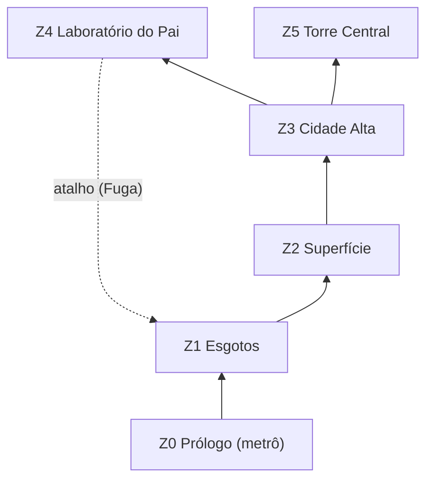
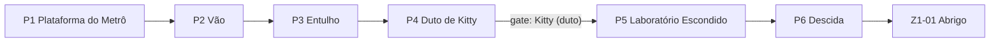
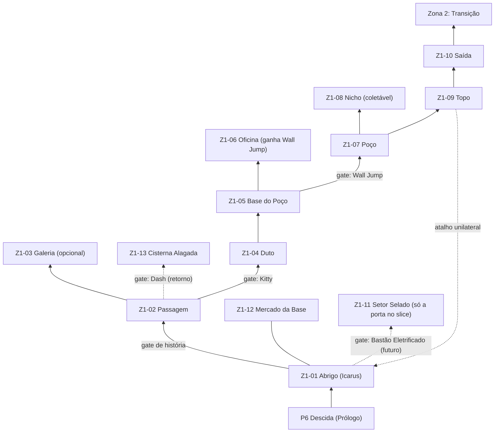

# Mapa de Níveis — Under The Rain

> Mapa macro das zonas, grafo de salas do **Prólogo (Zona 0)** e da **Zona 1 (Esgotos)** e a tabela chave × fechadura ampliada. Complementa o [GDD](gdd.md) §6.
>
> **Status:** todo o conteúdo deste mapa foi aprovado pelo usuário em 2026-11-13. A estrutura interna de cada sala (layout, plataformas, inimigos) fica a cargo do level design, dentro do escopo descrito aqui.
>
> **IDs de sala** = `RoomBounds.RoomId` no código. Salas já construídas mantêm seus IDs.

---

## 1. Taxonomia de Gates

| Tipo | O que bloqueia | Dureza | Exemplo no slice |
|---|---|---|---|
| **1. Progressão** | Sem a habilidade, não se muda de zona | Duro | Z1-07 Poço (Wall Jump) |
| **2. Salto de sala** | A habilidade é a única forma de ir de uma sala a outra da mesma zona, abrindo atalhos ou rotas | Duro | Z1-04 Duto (Kitty) |
| **3. Coletável** | Vida, bateria, mochila, documentos do Pai | Suave (precisão) | Z1-08 Nicho (célula de bateria) |
| **4. Retorno** | Voltar a uma zona antiga com a habilidade nova | Duro ou suave | Z1-11 Setor Selado (Bastão Eletrificado, futuro) |

**Regra:** todo gate é **legível**, ou seja, visível antes de poder ser superado (a plataforma alta, a porta sem energia, a luz no topo do poço). Os gates de história (por exemplo, a comporta leste depois de confrontar Icarus) são um caso à parte: abrem por um beat narrativo, não por habilidade.

---

## 2. Mapa Macro

| Zona | Nome | Ato | Status | Cena(s) |
|---|---|---|---|---|
| **0** | Prólogo — Estação de Metrô Abandonada | I | Em construção (Épico 5) | `Prologue_Ruins` |
| **1** | Esgotos — Base da Resistência | I | Em construção (Épico 5) | `Act1_Sewers` |
| 2 | Superfície | I → II | Aprovado (Épicos 7–8) | — |
| 3 | Cidade Alta | II | Aprovado (Épicos 7–8) | — |
| 4 | Laboratório do Pai | II (ponto médio) | Aprovado (Épicos 7–8) | — |
| 5 | Torre Central da Domus Corp | III | Aprovado (Épicos 7–8) | — |

A Zona 0 fica **fora** das 5 macrozonas do GDD. Ela é um tutorial de ~20–35 min, sem chuva (subsolo da cidade). A garoa só aparece na Zona 2.

### Zonas 2–5 em nível de zona

- **Z2 Superfície:** Transição (robô batedor + anomalia de Kitty) · Ruas (hub alagado) · Boss 1 — Humano Misantropo (rende o Mapa Criptografado) · Posto (abrigo; Dash) · Lasers (gate de Dash) · Data Center 1 (Boss 2; Bastão Eletrificado).
- **Z3 Cidade Alta:** Entrada (abrigo) · Distrito (hub neon) · Telhados (gate de Pulo Duplo) · Data Center 2 (Boss 3, Kaelen) · Ala de Pesquisa (opcional; Pulo Duplo).
- **Z4 Laboratório do Pai:** Antecâmara (Pulo Duplo) · Lab do Pai (ponto médio) · Fuga (Boss 4; abre atalho de volta ao Abrigo Z1-01).
- **Z5 Torre:** Base (abrigo) · Eixo (gate de Gancho) · Núcleo (vírus) · Titã (Boss 5).

---

## 3. Zona 0 — Prólogo (6 salas)

Estação de metrô desativada no subsolo. Atrás dela fica um **laboratório abandonado da Domus Corp**, onde se testava um novo modelo de robô de guerra que não foi adiante. Lá está o Terminal da Domus. O Prólogo ensina por level design, com placas curtas e sem muro de texto.

| # | Sala | ID | Ensina / contém | Status |
|---|---|---|---|---|
| P1 | Plataforma do Metrô | `prologue_metro_platform` | mover, pular, entulho de plataforma | **Existe** (5.1) |
| P2 | Vão | `prologue_gap` | pulo variável, coyote e buffer, sem dano | **Existe** (5.4) |
| P3 | Entulho | `prologue_debris` | bastão contra 1 Operário; célula de bateria + disparo | **Existe** (5.4) |
| P4 | Duto de Kitty | `prologue_duct` | Kitty atravessa o duto e abre a passagem (intro de `CatExploration`) | **Existe** (5.4) |
| P5 | Laboratório Escondido | `prologue_hidden_lab` | robô batedor + interferência de Kitty (`R`) + Terminal da Domus | **Existe** (5.1) |
| P6 | Descida | `prologue_descent` | descida rumo aos esgotos → Abrigo Z1-01 | **Existe** (5.4) |

> **Implementado (5.4):** P1 → P2 → P3 → P4 → P5 → P6 → Z1-01, com saídas nos dois sentidos. A volta do Abrigo chega no fundo de P6.

---

## 4. Zona 1 — Esgotos (13 salas)

A Zona 1 é a **base da resistência**. Pelo backtracking típico do metroidvania, o jogador vai passar várias vezes pelo Abrigo, onde ficam o ponto de descanso, a recarga de bateria e os mercadores. Os esgotos não têm chuva.

| # | Sala | ID | Tipo de gate / função | História |
|---|---|---|---|---|
| Z1-01 | Abrigo | `sewers_initial_shelter` | save/descanso, Icarus; porta do Selado visível desde o início; gate de história (comporta leste) | **Existe** (5.1) |
| Z1-02 | Passagem | `sewers_passage` | robô batedor + plataformas rumo ao poço | **Existe** (5.1) |
| Z1-03 | Galeria | `sewers_gallery` | opcional: combate com grupo de Operários; peças/bateria | 5.5 |
| Z1-04 | Duto | `sewers_duct` | **salto de sala:** Kitty abre a porta; única rota até a Base | 5.5 |
| Z1-05 | Base do Poço | `sewers_shaft_base` | gate legível: o poço e a luz no topo são visíveis | 5.2 |
| Z1-06 | Oficina | `sewers_workshop` | Dante ganha o **Wall Jump** (luvas de tração); treino seguro | 5.2 |
| Z1-07 | Poço | `sewers_shaft` | **gate de progressão:** Wall Jump | 5.2 |
| Z1-08 | Nicho | `sewers_alcove` | **coletável:** célula de bateria, gate suave de precisão | 5.2 |
| Z1-09 | Topo | `sewers_shaft_top` | **retorno recompensado:** atalho unilateral Topo → Abrigo | 5.2 |
| Z1-10 | Saída | `sewers_exit` | transição para a Superfície (Zona 2) | 5.2 |
| Z1-11 | Setor Selado | `sewers_sealed_sector` | só a porta no slice ("sem energia"); sala jogável no Épico 8 (Protótipo Mark-0) — **gate de retorno**: Bastão Eletrificado | Porta: 5.5 · Sala: Épico 8 |
| Z1-12 | Mercado da Base | `sewers_base_market` | anexo do Abrigo: mercadores e estação de recarga de bateria; os painéis de NPC chegam no Épico 6.3 | 5.5 |
| Z1-13 | Cisterna Alagada | `sewers_flooded_cistern` | opcional, ramificação da Passagem; **gate de retorno**: Dash (obtido na Z2) guardando uma expansão de mochila | Porta/vista: 5.5 · Conteúdo: Épico 7 |

> Z1-12 e Z1-13 completam as 13 salas (aprovadas). O agente de level design tem liberdade para detalhar o layout das duas, desde que mantenha o papel da Zona 1 como base da resistência e respeite a taxonomia de gates.

---

## 5. Tabela Chave × Fechadura (ampliada)

| Chave | Onde se obtém | Fechadura (gate legível) | Tipos de gate | Onde aparece |
|---|---|---|---|---|
| **Kitty — duto/terminal** | Desde o Prólogo (P4) | Dutos estreitos, painéis offline | Salto de sala, coletável | P4, Z1-04; portas de serviço nas zonas 2–5 |
| **Kitty — interferência** | Desde o Prólogo (P5) | Robôs da colmeia (combate) | — (ferramenta de combate) | Todas as zonas; ignorada por Misantropos |
| **Wall Slide & Wall Jump** | Z1-06 Oficina | Poços verticais, chaminés, paredes paralelas, nichos | Progressão, coletável, retorno | Z1-07, Z1-08; chaminés nas zonas 2–5 |
| **Dash Tático** | Z2 Posto | Vãos largos, corredores com lasers | Progressão, retorno | Z2 Lasers, rota alternativa ao DC 1, Z1-13 |
| **Bastão Eletrificado** | Z2 Data Center 1 (Boss 2) | Fusíveis/bobinas descarregadas, escudos leves, portas sem energia | Retorno, salto de sala | Z1-11 Setor Selado, rotas secretas |
| **Propulsor Aéreo (Pulo Duplo)** | Z3 (Boss 3 / Ala de Pesquisa) | Plataformas isoladas sem parede de apoio | Progressão, coletável | Z3 Telhados, Z4 Antecâmara |
| **Gancho Magnético** | Z4/Z5 | Pontos de ancoragem metálicos em altura | Progressão | Z5 Eixo, telhados altos e torres |
